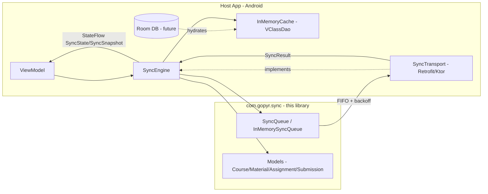

# VClass Offline Sync Engine

> Offline-first sync engine untuk Gunadarma VClass: library Kotlin dengan cache in-memory ala Room dan interface queue yang tahan antar operasi.

Portfolio project oleh **Gopyr Informatics, Gunadarma University**. Dibangun sebagai Android library module sungguhan, bukan demo buangan.

## Scope jujur

**Yang ini adalah:**
- Library Kotlin/JVM (`com.gopyr.sync`) yang memberi aplikasi Android optimistic offline writes, FIFO queue dengan exponential backoff, surfacing konflik, dan sync state berbasis `StateFlow` untuk ViewModel.
- Termasuk `VClassDao` + `InMemoryCache` yang meniru Room DAO, dan `SyncQueue` + `InMemorySyncQueue` yang meniru queue Room.
- Transport-agnostic: kamu inject `SyncTransport` (Retrofit/Ktor di aplikasi asli). Tidak ada kode jaringan di dalam library.
- Dites di JVM dengan `kotlinx-coroutines-test`: logika inti tidak butuh Android instrumentation.

**Yang ini belum:**
- Bukan aplikasi VClass penuh; ini lapisan sync saja.
- Belum memakai `androidx.room:room-runtime` asli: lihat [Limitations](#limitations) untuk jalur migrasinya.
- Belum dites untuk durability antar proses mati: store in-memory reset saat app dibunuh (by design untuk library; host yang mempertahankan kalau perlu).
- Belum menangani resumable upload file/binary: payload berupa string JSON; file besar butuh uploader terpisah.

## Arsitektur



**Alur:**
1. Aksi user saat offline (misal `submitAssignmentOffline()`) → tulis ke `InMemoryCache` sebagai `QUEUED` (optimistic) + `enqueue()` sebuah `SyncOperation`.
2. Saat koneksi kembali, caller panggil `engine.sync()` (atau `startPeriodicSync()`). Engine menguras FIFO dan memanggil `transport.execute(op)` secara berurutan.
3. Sukses → dequeue + tandai entri cache `SYNCED`. Gagal → exponential backoff (`2^n` detik, cap 5 menit), retry sampai `maxRetries`. Konflik → ditampilkan lewat callback `onConflict`; default `KEEP_SERVER`.
4. UI meng-collect `engine.state` / `engine.snapshot` (`StateFlow`) untuk menampilkan jumlah pending/gagal.

## Struktur project

```
vclass-sync/
├── build.gradle.kts                  # kotlin-jvm + coroutines + JUnit5
├── settings.gradle.kts
├── src/main/kotlin/com/gopyr/sync/
│   ├── Models.kt                     # domain models + SyncTransport interface
│   ├── Cache.kt                      # VClassDao + InMemoryCache (Room-like)
│   ├── Queue.kt                      # SyncQueue + InMemorySyncQueue
│   └── SyncEngine.kt                 # orchestrator, StateFlow, retry, conflicts
└── src/test/kotlin/com/gopyr/sync/
    └── SyncEngineTest.kt
```

## Usage

```kotlin
// 1. Implement transport (contoh Retrofit)
class VClassTransport(private val api: VClassApi) : SyncTransport {
    override suspend fun execute(op: SyncOperation): SyncResult = try {
        when (op.type) {
            SyncOperationType.CREATE_SUBMISSION -> api.createSubmission(op.payloadJson)
            else -> api.generic(op)
        }
        SyncResult(op.id, SyncStatus.SUCCEEDED)
    } catch (e: Exception) {
        SyncResult(op.id, SyncStatus.FAILED, error = e.message)
    }
    override suspend fun fetchServerVersion(op: SyncOperation): Long? =
        api.getVersion(op.id)?.updatedAt
}

// 2. Wire engine (misal di Hilt module atau Application)
val engine = SyncEngine(
    transport = VClassTransport(api),
    conflictStrategy = ConflictStrategy.KEEP_SERVER,
    onConflict = { conflict -> ConflictStrategy.KEEP_SERVER }
)

// 3. Tulis offline (jalan tanpa jaringan)
val submission = Submission("sub1", "assignment1", "student123", "jawaban saya")
engine.submitAssignmentOffline(submission) // cache = QUEUED, queue = PENDING

// 4. Sync saat online (panggil dari WorkManager / connectivity callback)
lifecycleScope.launch { engine.sync() }

// 5. Observasi di ViewModel / Compose
viewModelScope.launch {
    engine.snapshot.collect { snap ->
        // snap.pendingCount, snap.failedCount, snap.state
    }
}
```

## Build & test

```bash
# Butuh JDK 17 + Gradle 8.x
gradle test
gradle publishToMavenLocal   # untuk dikonsumsi aplikasi Android via mavenLocal()
```

> Catatan CI: `kotlinc`/`java` tidak dibutuhkan hanya untuk membaca kode; test jalan di JDK 17 runner apa pun.

## Keterbatasan (jujur)

| Area | Saat ini | Jalur ke aplikasi nyata |
|------|---------|---------------|
| **Persistence** | In-memory saja; proses mati menghapus queue/cache | Ganti `InMemoryCache`/`InMemorySyncQueue` dengan implementasi Room `@Dao` + `@Entity` di balik interface yang sama; re-enqueue di `Application.onCreate` dari Room |
| **Room** | Tanpa dependensi `room-runtime`/`ksp` agar library tetap ringan | Tambah `androidx.room:room-runtime`, annotate entities, jadikan `VClassDao` `@Dao` sungguhan |
| **Queue durability** | `nextRetryAt` dicek di `peek()` tapi tidak dipersistenkan | Kolom Room `nextRetryAt` + `WorkManager` untuk retry yang tahan antar proses |
| **File upload** | Payload JSON saja | Integrasi `WorkManager` + resumable upload (misal Tus) untuk `filePath` |
| **Conflict merge** | `MERGE_MANUAL` menghentikan queue; tidak ada auto-merge | Merge tingkat field per tipe entity |
| **Connectivity** | Caller yang memicu `sync()` | Tambah `ConnectivityManager.NetworkCallback` → auto `sync()` |
| **Multi-device** | Tidak ada vector clock / CRDT | `updatedAt` server yang menang; pertimbangkan version vector kalau perlu |

## Roadmap

- [ ] Implementasi `PersistentCache` + `PersistentQueue` berbasis Room
- [ ] Worker periodic sync dengan `WorkManager`
- [ ] Resumable file upload untuk lampiran submission
- [ ] Merge tingkat field untuk `MERGE_MANUAL`

## Author

Gopyr, mahasiswa Informatika di Gunadarma University. Library portfolio; kontribusi dipersilakan.

## Lisensi

MIT
