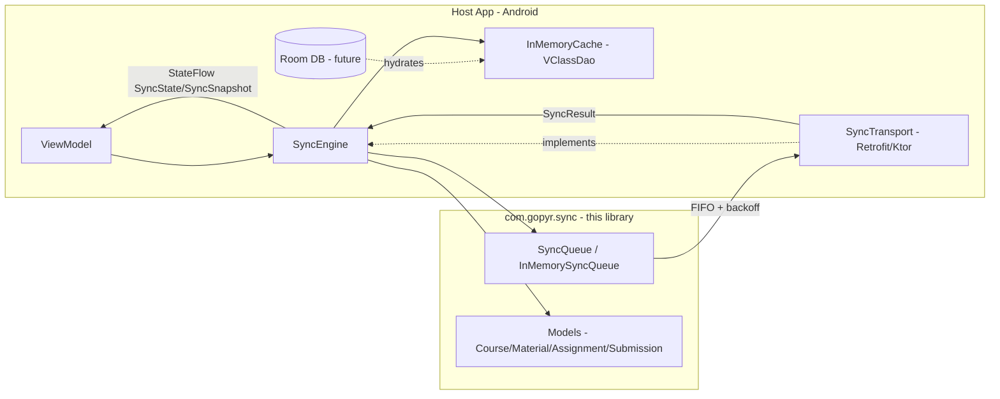

# VClass Offline Sync Engine

> Offline-first sync engine for Gunadarma VClass — Kotlin library with Room-like in-memory cache + durable-queue interface.

Portfolio project by **Gopyr Informatics, Gunadarma University**. Built as a real Android library module, not a demo throwaway.

## Honest Scope

**What this is:**
- A Kotlin/JVM library (`com.gopyr.sync`) that gives an Android app optimistic offline writes, a FIFO queue with exponential backoff, conflict surfacing, and a `StateFlow`-based sync state for ViewModels.
- Includes a `VClassDao` + `InMemoryCache` that mirrors a Room DAO, and a `SyncQueue` + `InMemorySyncQueue` that mirrors a Room-backed queue.
- Transport-agnostic: you inject `SyncTransport` (Retrofit/Ktor in the real app). No network code inside the library.
- Tested on JVM with `kotlinx-coroutines-test` — no Android instrumentation needed for core logic.

**What this is NOT (yet):**
- Not a full VClass app — it is the sync layer only.
- Not using real `androidx.room:room-runtime` — see [Limitations](#limitations) for the migration path.
- Not durability-tested across process death — in-memory stores reset on kill (by design for the library; host persists if needed).
- Not handling file/binary upload resumability — payloads are JSON strings; large files need a separate uploader.

## Architecture



**Flow:**
1. User action while offline (e.g. `submitAssignmentOffline()`) → write to `InMemoryCache` as `QUEUED` (optimistic) + `enqueue()` a `SyncOperation`.
2. When connectivity returns, caller invokes `engine.sync()` (or `startPeriodicSync()`). Engine drains FIFO, calls `transport.execute(op)` sequentially.
3. On success → dequeue + mark cache entry `SYNCED`. On failure → exponential backoff (`2^n` sec, cap 5 min), retry up to `maxRetries`. On conflict → surface via `onConflict` callback; default `KEEP_SERVER`.
4. UI collects `engine.state` / `engine.snapshot` (`StateFlow`) to show pending/failed counts.

## Project Structure

```
vclass-sync/
├── build.gradle.kts                  # kotlin-jvm + coroutines + JUnit5
├── settings.gradle.kts
├── src/main/kotlin/com/gopyr/sync/
│   ├── Models.kt                     # domain models + SyncTransport interface
│   ├── Cache.kt                      # VClassDao + InMemoryCache (Room-like)
│   ├── Queue.kt                      # SyncQueue + InMemorySyncQueue
│   └── SyncEngine.kt                 # orchestrator, StateFlow, retry, conflicts
└── src/test/kotlin/com/gopyr/sync/
    └── SyncEngineTest.kt
```

## Usage

```kotlin
// 1. Implement transport (Retrofit example)
class VClassTransport(private val api: VClassApi) : SyncTransport {
    override suspend fun execute(op: SyncOperation): SyncResult = try {
        when (op.type) {
            SyncOperationType.CREATE_SUBMISSION -> api.createSubmission(op.payloadJson)
            else -> api.generic(op)
        }
        SyncResult(op.id, SyncStatus.SUCCEEDED)
    } catch (e: Exception) {
        SyncResult(op.id, SyncStatus.FAILED, error = e.message)
    }
    override suspend fun fetchServerVersion(op: SyncOperation): Long? =
        api.getVersion(op.id)?.updatedAt
}

// 2. Wire engine (e.g. in Hilt module or Application)
val engine = SyncEngine(
    transport = VClassTransport(api),
    conflictStrategy = ConflictStrategy.KEEP_SERVER,
    onConflict = { conflict -> ConflictStrategy.KEEP_SERVER }
)

// 3. Offline write (works with no network)
val submission = Submission("sub1", "assignment1", "student123", "jawaban saya")
engine.submitAssignmentOffline(submission) // cache = QUEUED, queue = PENDING

// 4. Sync when online (call from WorkManager / connectivity callback)
lifecycleScope.launch { engine.sync() }

// 5. Observe in ViewModel / Compose
viewModelScope.launch {
    engine.snapshot.collect { snap ->
        // snap.pendingCount, snap.failedCount, snap.state
    }
}
```

## Build & Test

```bash
# Requires JDK 17 + Gradle 8.x
gradle test
gradle publishToMavenLocal   # to consume from an Android app via mavenLocal()
```

> CI note: `kotlinc`/`java` not required to read the code; tests run on any JDK 17 runner.

## Limitations (honest)

| Area | Current | Real-app path |
|------|---------|---------------|
| **Persistence** | In-memory only; process death wipes queue/cache | Replace `InMemoryCache`/`InMemorySyncQueue` with Room `@Dao` + `@Entity` impls behind the same interfaces; re-enqueue on `Application.onCreate` from Room |
| **Room** | No `room-runtime`/`ksp` dependency to keep library lightweight | Add `androidx.room:room-runtime`, annotate entities, keep `VClassDao` as actual `@Dao` |
| **Queue durability** | `nextRetryAt` checked in `peek()` but not persisted | Room column `nextRetryAt` + `WorkManager` for durable retries |
| **File uploads** | JSON payloads only | Integrate `WorkManager` + resumable upload (e.g. Tus) for `filePath` |
| **Conflict merge** | `MERGE_MANUAL` pauses queue; no auto-merge | Implement field-level merge per entity type |
| **Connectivity** | Caller triggers `sync()` | Add `ConnectivityManager.NetworkCallback` → auto `sync()` |
| **Multi-device** | No vector clocks / CRDT | Server `updatedAt` wins; consider version vectors if needed |

## Roadmap

- [ ] Room-backed `PersistentCache` + `PersistentQueue` implementations
- [ ] `WorkManager` periodic sync worker
- [ ] Resumable file upload for submission attachments
- [ ] Field-level merge for `MERGE_MANUAL`

## Author

Gopyr — Informatics, Gunadarma University. Portfolio library; contributions welcome.

## License

MIT
